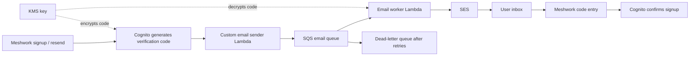

# AWS portfolio plan on a minimal budget

Status: foundation and hosted-login bridge implemented locally; AWS deployment
and live acceptance checks pending. See [implementation guide](../infra/aws/README.md).
Later export/canvas-worker/Step Functions features remain proposals.
Audited against `bbfec7f` on 2026-10-26. Prices below are USD, with
`us-east-1` as the intended region. This is a repository audit, not a live AWS
inventory or billing audit. Existing account usage shares free allowances.

## Objective and spending target

Give AWS services useful jobs in Meshwork while keeping incremental spending
close to zero. Keep the existing EC2 application host, PostgreSQL, Redis, and
NGINX. Add managed identity, durable email delivery, off-host backups,
observability, scheduled operations, and identity-based deployment access.

Target approximately **$1–$3/month in additions at small portfolio traffic**,
subject to the usage assumptions below. This excludes existing EC2, EBS,
public IPv4, domain registration, taxes, and AI provider spending. Temporary
AWS credits are not the basis of this design. Literal perpetual $0 is not a
credible promise for S3 storage plus SES delivery, and the proposed Cognito
custom sender has a customer-managed KMS key with a monthly charge.

## Repository findings

| Area                            | Evidence                                                                                                                                                      | Planning implication                                                                                                                                                                                       |
| ------------------------------- | ------------------------------------------------------------------------------------------------------------------------------------------------------------- | ---------------------------------------------------------------------------------------------------------------------------------------------------------------------------------------------------------- |
| Deployment                      | `docs/infrastructure/INFRASTRUCTURE.md`: one EC2 with Node, Go auth, PostgreSQL, Redis, and NGINX                                                             | Extend this deployment; do not rebuild it around containers or a load balancer.                                                                                                                            |
| Verification and password reset | `server/services/auth/internal/httpapi/handlers_flows.go`: local hashed tokens and background goroutines send SMTP messages                                   | A durable mail queue solves a real gap: a process exit can interrupt delivery, and there is no durable email retry queue. Current verification uses links, so a code-entry flow requires application work. |
| Existing verification bug       | `handleVerifyEmail` assigns `token := body.Token` before `readJSON`; the unchanged empty local value causes fallback to a query token                         | Test and correct JSON verification before relying on the existing flow during migration. No fix is included in this proposal.                                                                              |
| Identity                        | Go owns passwords, MFA, OAuth, opaque sessions, signed assertions, admin status, audit events, and revocation                                                 | Cognito adoption requires an application migration and preservation of local user IDs. Creating a pool alone does not migrate authentication.                                                              |
| Backups                         | `scripts/backup-db.ts`, `scripts/restore-drill.ts`, `docs/operations/RECOVERY.md` already define S3 archives, checksums, isolated restores, and DynamoDB PITR | Provision and verify the missing operational foundation around these tools. The repository explicitly does not prove that production backups are configured.                                               |
| Canvas                          | `server/services/canvas/db/dynamo.ts` uses DynamoDB on-demand, strongly consistent queries, revisions, and write leases                                       | Keep existing persistence; measure request units before considering provisioned capacity. A save can read a whole canvas even when few items change.                                                       |
| Background work                 | Workspace PostgreSQL outbox atomically records duplication and cleanup events, then dispatches them in-process                                                | Preserve transactional outbox semantics if delivery moves to SQS. Queue publication cannot atomically replace the existing SQL transaction.                                                                |
| Observability                   | Structured request IDs, local Prometheus endpoints, admin dashboard, on-box health watch, and GitHub external witness exist                                   | Add remote log retention and independent alarms. Avoid duplicating every existing metric into paid custom metrics.                                                                                         |
| Historical Terraform            | `docs/archive/terraform/` contains RDS, ElastiCache, ECS, networking, and frontend hosting examples, with obsolete/invalid resource definitions               | Author a fresh Terraform root for these additions. The archive is not a deployable starting point.                                                                                                         |

## 1. Verification email through Cognito, SQS, and Lambda

The preferred portfolio design retains Cognito as the identity authority and
uses a queue specifically for email delivery:

Cognito owns code generation, expiry, verification, and account state. The
delivery worker only sends mail. Signup, resend, password-reset, and email
attribute verification events need explicit template handling; unsupported
trigger sources must not silently succeed. Passwordless email login and SMS
MFA are outside the initial scope.

AWS's `CustomEmailSender` trigger receives an encrypted code. The intake
Lambda validates the event and publishes only required recipient, source,
timestamp, event ID, and encrypted-code fields. It must report failure if
publication fails. The worker decrypts using the AWS Encryption SDK and a
restricted KMS key, verifies the expected user-pool encryption context, renders
an allowlisted template, and calls SES. It never logs the code or message body.
This queue-based composition is our proposed design using AWS's sender hook,
not a built-in Cognito-to-SQS integration. See
[custom sender setup](https://docs.aws.amazon.com/cognito/latest/developerguide/user-pool-lambda-custom-sender-triggers.html)
and [sender events](https://docs.aws.amazon.com/cognito/latest/developerguide/user-pool-lambda-custom-email-sender.html).

Queue requirements:

- Standard queue plus a DLQ; SSE-SQS encryption avoids a second custom KMS key.
- Standard Lambda polling mode, bounded concurrency/timeouts, long polling,
  visibility timeout appropriate to execution time, and partial batch failures.
- Stable job IDs and a short-lived delivery ledger in DynamoDB for deduplication.
  SES acceptance and ledger writes are not atomic: a crash can still cause a
  duplicate email. Never promise exactly-once delivery.
- An explicit message send deadline, bounded retries, and an alarm on messages
  in the DLQ or an ageing backlog. Discard stale jobs instead of delivering
  codes after their useful lifetime. SQS TTL alone is not an expiry check.
- Resend limits and an application-level daily mail budget. Lambda concurrency
  limits throughput, not total monthly spending. Expired DLQ jobs are not
  automatically replayed.
- SES verified sender/DKIM and production access for arbitrary recipients.
  [Sandbox accounts](https://docs.aws.amazon.com/ses/latest/dg/request-production-access.html)
  restrict recipients and allow only 200 messages/day and one message/second.
- SES bounce/complaint notifications through SNS to a small feedback Lambda;
  maintain suppression state and do not repeatedly retry permanent failures.

**Cost tradeoff:** Cognito Lite/Essentials has 10,000 free direct/social MAUs
per month. Custom sender encryption requires a customer-managed KMS key,
initially about $1/month plus usage. SES is metered: current Essentials
outbound pricing starts at $0.16/1,000 recipients; available à-la-carte pricing
is $0.10/1,000. Verify the actual account plan. These costs cannot be removed
by putting SQS in front of SES.
[Cognito pricing](https://aws.amazon.com/cognito/pricing/),
[KMS pricing](https://aws.amazon.com/kms/pricing/),
[SES pricing](https://aws.amazon.com/ses/pricing/).

The lowest-cost alternative is to keep Go authentication and enqueue its own
verification messages to SQS, with Lambda delivering through SES. This avoids
Cognito's custom-sender key requirement but leaves token security and identity
management in our application. If this alternative is chosen, create token
and email-outbox rows in one SQL transaction; use an appropriate protected
delivery payload and never log tokens. Another option is Cognito's native
email delivery with SQS reserved for other notifications, but that does not
demonstrate queued verification delivery.

### Cognito application migration

Start with a separate pool and a non-production account flow. Adapt the Go
service to exchange/validate Cognito authentication while initially retaining
its app-facing HttpOnly session and signed-assertion bridge. This gives existing
Node authorization and WebSocket code a controlled migration path.

Map `(issuer, sub)` to the existing local user ID; preserve workspace ownership,
collaborator grants, team roles, admin status, and audit references. Do not
merge accounts just because an email string matches. Test Google identity
linking, verification state, password recovery, TOTP, session revocation,
logout-all, and active WebSocket disconnects. Cognito confirmation becomes the
authority for its accounts; do not also validate a second local code.

Assess existing password hash formats against current Cognito import support;
otherwise choose staged password resets or a migration trigger after designing
secure access to the legacy verifier. Do not expose PostgreSQL for Lambda
access. [AWS migration guide](https://docs.aws.amazon.com/cognito/latest/developerguide/cognito-user-pools-import-using-lambda.html).

## 2. S3 database backups with completion monitoring

Provision a dedicated private backup bucket with Block Public Access,
versioning, SSE-S3, TLS enforcement, incomplete multipart cleanup, and
expiration of current/noncurrent archive versions. Start with 14 days of daily
archives and a small retained monthly set if desired. Define their prefixes
and lifecycle rules explicitly; versioning by itself does not enforce retention
or make objects immutable. Avoid Glacier/IA transitions for short retention.

Run the existing dump tool on EC2 using its nightly systemd timer. EC2 can
reach local PostgreSQL directly; a Lambda should not be given internet access
to the database. Use an instance role scoped to the backup prefix. The current
tool calls the AWS CLI for uploads, so either install it on EC2 or replace that
upload step with the SDK during implementation; it is not required on the
developer's machine for this plan.

The final manifest marks archive completion. Add a daily Scheduler -> Lambda
check for the latest complete archive; emit one backup-age metric and alert
when a scheduled archive is overdue. A manifest upload can trigger validation
of referenced object sizes, while full checksum and database restore validation
remain part of the existing isolated restore drill. Measure recovery time and
record the result as portfolio evidence.

S3 storage/requests and DynamoDB PITR remain metered. Preserve the current
production PITR requirement. AWS quotes DynamoDB PITR at $0.20/GB-month in its
recovery comparison; restores add usage charges.
[S3 pricing](https://aws.amazon.com/s3/pricing/),
[DynamoDB recovery costs](https://docs.aws.amazon.com/amazondynamodb/latest/developerguide/DynamodbDisasterRecoveryStrategy.html).

## 3. CloudWatch observability and external health checks

Collect Node/Go JSON logs, NGINX errors, and backup outcomes with the
CloudWatch agent. Start with 7-day app/Lambda log retention, low-volume
30-day operational logs, existing redaction, and no debug/body logging.
Keep request IDs in logs; do not use user, request, or workspace IDs as custom
metric dimensions. Do not emit an unbounded metric series for dynamic URLs.

Use one dashboard and these initial standard-resolution alarms:

1. EC2 status check failure.
2. Disk space low.
3. Public application probe failed, including missing probe data.
4. Backup stale, including missing successful-backup data.
5. Email DLQ has messages.
6. Email queue oldest-message age exceeds the chosen delivery target.
7. Email worker errors.
8. Application 5xx count exceeds a small sustained threshold.

Export at most five custom series initially: memory utilization, disk
utilization for one mount, public availability, backup age, and app 5xx count.
Use existing service metrics for EC2, SQS, and Lambda. Missing-data handling
depends on the signal: missing queue traffic is normal; a missing heartbeat
must not appear healthy.

For a check independent of the EC2 host, use EventBridge Scheduler every five
minutes -> non-VPC Lambda -> the public HTTPS health endpoint. Bound request
timeouts, follow a fixed allowlisted URL, and publish the availability metric.
Keep the GitHub witness until this path is verified. Send CloudWatch alerts to
an SNS email subscription, which needs the recipient to confirm it.

The published monthly allowances include 5 GB logs, 10 custom/detailed
monitoring metrics, 10 eligible alarm metrics, and three custom dashboards
with up to 50 metrics each. Scheduler includes 14 million invocations; SNS
includes 1,000 email notifications. Allowances are shared, and some APIs and
advanced observability features have separate charges.
[CloudWatch](https://aws.amazon.com/cloudwatch/pricing/),
[Scheduler](https://aws.amazon.com/eventbridge/pricing/),
[SNS allowances](https://aws.amazon.com/tr/sns/faqs/).

## 4. Server access, configuration, and deployment identity

- **Systems Manager Session Manager:** browser-based access to the existing EC2
  with IAM, then migrate operational commands away from shared SSH keys.
  Session Manager for EC2 has no additional service charge. Use the host's
  existing outbound connectivity; do not add paid interface endpoints merely
  for this single-host design.
- **Parameter Store:** standard configuration and small `SecureString` secrets;
  read at boot/deployment with the instance role and cache locally. Standard
  parameters/default throughput have no additional SSM charge. KMS use still
  follows its pricing; avoid creating extra customer-managed keys by default.
- **GitHub Actions OIDC -> AWS IAM role:** temporary deployment credentials,
  narrowly trusted to this repository and deployment environment. Use SSM with
  a fixed deploy document targeting this instance. Trusted-branch Terraform
  plans run in CI; untrusted fork PRs get static validation without AWS roles.
- **AWS Budgets:** a small incremental-spend budget plus an account-total
  budget that includes EC2. Email alerts are free; budgets are alerts, not
  hard spending caps.
- **CloudTrail:** use the free 90-day management event history; optionally keep
  one management-event trail in a separate S3 audit bucket with lifecycle rules.
  The first management-event copy has no CloudTrail delivery fee, but S3 does.

[Session Manager](https://docs.aws.amazon.com/prescriptive-guidance/latest/aws-startup-security-baseline/wkld-06.html),
[Parameter Store pricing](https://aws.amazon.com/systems-manager/pricing/),
[Budgets](https://aws.amazon.com/aws-cost-management/aws-budgets/pricing/),
[CloudTrail](https://aws.amazon.com/cloudtrail/pricing/).

## 5. Later features with useful portfolio demonstrations

| Priority | Feature                                                 | Proposed services                                                           | Demonstration and limits                                                                                                                                                                                                                |
| -------- | ------------------------------------------------------- | --------------------------------------------------------------------------- | --------------------------------------------------------------------------------------------------------------------------------------------------------------------------------------------------------------------------------------- |
| Next     | Async canvas JSON exports and temporary share downloads | Existing API -> SQS -> Lambda -> private S3; small DynamoDB job ledger      | Shows job status, retries, workspace authorization, and short-lived presigned downloads. Expire exports after 24 hours. Start with JSON; image rendering adds more compute and packaging.                                               |
| Next     | Canvas cleanup/duplication worker                       | Existing SQL outbox -> SQS -> Lambda -> existing DynamoDB table             | Shows cross-store eventual consistency. Keep the SQL outbox, stable event IDs, and idempotent operations; reconcile completion back to the app before replacing the current dispatcher.                                                 |
| Optional | Backup workflow orchestration                           | Scheduler -> Step Functions Standard -> SSM Run Command -> S3 checks -> SNS | Shows observable workflow state and failure handling. Bound polling/retries; do not run it alongside a second nightly backup scheduler. Standard includes 4,000 transitions/month; target under 1,000. EC2 work and S3 remain billable. |
| Optional | SES delivery feedback                                   | SES -> SNS -> Lambda -> suppression/delivery ledger                         | Shows bounce/complaint handling and prevents repeatedly mailing failed recipients. Keep message content out of operational logs.                                                                                                        |

These are candidates, not a requirement to add all of them. Start with one
active SQS consumer queue; each extra Lambda-polled queue adds idle polling
requests. All send/receive/delete calls, including empty receives, count toward
SQS usage. [SQS polling](https://docs.aws.amazon.com/prescriptive-guidance/latest/modernization-integrating-microservices/sqs.html),
[Step Functions pricing](https://aws.amazon.com/step-functions/pricing/).

## Cost model and service selection

| Service                  | Ongoing allowance or charge                                                                          | Initial choice                                                                          |
| ------------------------ | ---------------------------------------------------------------------------------------------------- | --------------------------------------------------------------------------------------- |
| Cognito                  | 10,000 direct/social MAUs/month on Lite/Essentials                                                   | One pool; Lite unless an Essentials feature is needed. Avoid Plus and SMS.              |
| Lambda                   | 1 million requests and 400,000 GB-seconds/month                                                      | On-demand invocation, no provisioned concurrency/pollers.                               |
| SQS                      | 1 million requests/month                                                                             | One email queue plus DLQ initially; use long polling and batching.                      |
| SES                      | $0.16/1,000 outbound recipients on Essentials; $0.10/1,000 à la carte                                | Verified domain, small daily application budget, no dedicated IP/add-ons.               |
| KMS                      | $1/month for the initial custom-sender key; requests have an allowance                               | One custom key for Cognito sender only. Key rotations can increase key storage charges. |
| S3                       | Storage and API usage                                                                                | Private backup storage with bounded retention; SSE-S3.                                  |
| DynamoDB                 | 25 GB Standard storage; provisioned mode includes 25 RCU/25 WCU free; on-demand requests are metered | Retain on-demand canvas behavior initially. Add tiny job state only when used.          |
| CloudWatch/SNS/Scheduler | Fit bounded usage into the allowances above                                                          | One dashboard, eight alarms, five custom series initially.                              |
| SSM/IAM/OIDC/Budgets     | Core services described above have no added service charge                                           | Adopt for operations and access. Related storage/KMS/CI usage can still cost.           |

[Lambda pricing](https://aws.amazon.com/lambda/pricing/),
[SQS pricing](https://aws.amazon.com/sqs/pricing/),
[DynamoDB pricing](https://aws.amazon.com/dynamodb/pricing/).

Illustrative monthly additions, assuming applicable free allowances are still
available: 1,000 SES emails about $0.16; one unrotated custom KMS key $1;
5 GB average S3 Standard storage roughly $0.12 in N. Virginia; 1 GB of protected
DynamoDB table data roughly $0.20 for PITR; modest API requests add cents.
This is why roughly $1–$3/month is a reasonable target rather than a guarantee.
It is not a forecast of the existing production bill. Backup storage means
**all retained archives and versions**, not just current database size.

Do not select Aurora/RDS, ElastiCache, ALB, NAT Gateway, ECS/Fargate, EKS,
OpenSearch, managed Grafana, or paid security subscriptions for this roadmap.
S3 frontend hosting/CloudFront is excluded by preference. API Gateway is not
needed while the existing API handles public application requests. SES handles
transactional email; SNS email subscriptions are for operator notifications.
Keep serverless workers out of a VPC unless a measured requirement changes
the design. Use AWS-owned/service-managed encryption where possible; do not
create a customer-managed KMS key for every resource.

## Terraform scope and implementation order

Create a new `infra/aws/` root with separate components for foundation/IAM,
backup storage, observability, identity, and email delivery. Export instance-role
policies, backup URI, pool/client IDs, queue URLs, and log-group names. Preserve
the existing EC2 and any existing canvas table through data references or
explicitly reviewed imports. Terraform state/bootstrap has its own bucket and
is not mixed with short-lived backup retention.

1. **Foundation and visibility:** inventory live resources read-only when AWS
   access is available; add bounded logging/alarms, budget alerts, instance
   roles/SSM, S3 storage, nightly backup verification, and GitHub OIDC.
2. **Identity and queued mail:** build Cognito plus the custom sender, SQS/DLQ,
   worker/feedback Lambdas, and SES identity in a test environment. Exercise
   signup, code entry, resend, recovery, retry, stale job, and delivery failure.
3. **Application migration:** introduce the Cognito-to-existing-session bridge,
   preserve identity mappings and authorization, verify existing user migration,
   then cut over after end-to-end checks. Terraform cannot perform this step
   by itself.
4. **One additional feature:** choose async exports or a backup state machine.
   Record an architecture diagram, IAM boundaries, successful backup/restore
   evidence, queue-failure recovery, and a measured cost screenshot for the
   portfolio.

The developer machine does not need AWS CLI for Terraform authoring. Terraform
planning/apply still needs credentials in the execution environment; a trusted
GitHub workflow with OIDC or a configured AWS browser shell can supply them.
Plan/validate can be automated, while applying a reviewed plan is a deployment
step. This proposal creates no paid AWS resources or Terraform configuration.
