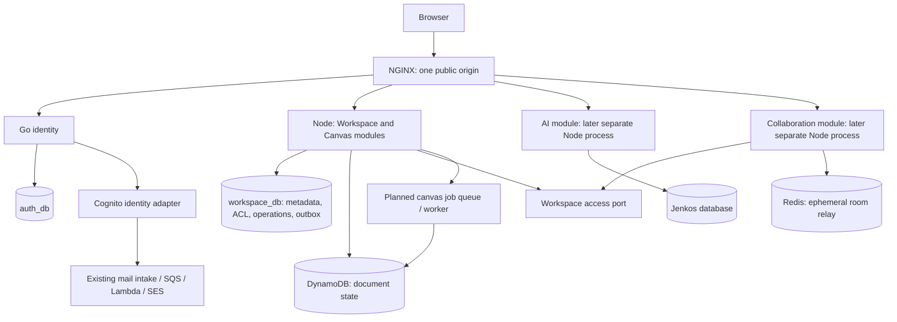

# Service boundary audit and extraction plan

Status: audited on 2026-10-26; recommendations are planned, not implemented.
Scope: local `bbfec7f` checkout plus the uncommitted AWS foundation/auth changes.
This reviews executable code and deployment definitions, not live AWS resources.

Implementation is tracked in [GitHub issue #49](https://github.com/Andiewitz/Meshwork-Studio/issues/49)
with [12 implementation issues](issues/service-boundaries/README.md). Filing the
issues does not change the implementation status of these findings.

## Assessment

Meshwork is a modular Node monolith with an already separate Go identity
service and locally implemented AWS workers. Its database separation is a good
foundation. Its application APIs, background delivery, and lifecycle management
are not yet sufficient to extract every `server/services/*` directory safely.

The useful target is **independently extractable modules deployed together**.
Keep NGINX, EC2, PostgreSQL, and Redis. Use typed local calls while modules share
a process; introduce HTTP or queues when a deployment boundary actually exists.
Separate PostgreSQL databases do not require separate PostgreSQL servers.

Do not spend effort extracting Teams: the existing
[collaborators plan](COLLABORATORS-REPLACEMENT-PLAN.md) already proposes its
retirement. Collaborator persistence exists, but live HTTP and WebSocket guards
still use Team roles. Completing that transition is a prerequisite, including
its explicit grant-cutover and database-retention procedure.

## Current ownership and extraction suitability

| Area               | Current boundary                                                                               | Recommendation                                                                                                                                                                       |
| ------------------ | ---------------------------------------------------------------------------------------------- | ------------------------------------------------------------------------------------------------------------------------------------------------------------------------------------ |
| Identity           | Separate Go process; `auth_db`, sessions, audit, Redis; Node validates signed assertions       | Preserve this boundary. Go remains the application identity/session authority with Cognito as an upstream identity provider.                                                         |
| Workspace          | Metadata, collections, collaborator rows, SQL outbox in `workspace_db`                         | Own resource existence, ownership, grants, and lifecycle orchestration. Remain the core of a Documents module.                                                                       |
| Canvas             | DynamoDB document persistence; routes obtain Workspace and Team repositories                   | Keep a private document engine behind a narrow API. Extract its background execution before considering the interactive API.                                                         |
| Teams              | `team_db`, sharing roles, ownership mirror, WebSockets                                         | Finish replacement by workspace collaborators. Do not turn this temporary model into a standalone microservice.                                                                      |
| Realtime           | WebSockets under Team; room maps and role cache; Redis relay                                   | Make a distinct Collaboration module with a Workspace access port. A separate EC2 process becomes useful only after removal/revocation and multi-process behavior pass tests.        |
| AI/Jenkos          | Own schemas, provider adapters, encrypted credentials, conversation/memory storage, SSE routes | Strongest next interactive-service candidate: it has distinct secrets, external failures, and long requests. Keep provider adapters inside this domain.                              |
| Metrics            | Own SQL history, but reads the monolith's in-memory registry and calls other modules over HTTP | Treat as platform support. Fix correctness and remove its ability to block core boot; use CloudWatch for operations. Preserve the admin history feature unless deliberately retired. |
| Email              | Cognito-specific intake, queue, worker, SES feedback, own delivery ledger                      | A real asynchronous boundary implemented locally. Keep Cognito event/decryption details in its adapter; it is not yet a generic notification API.                                    |
| Backups/monitoring | Recovery scripts and Lambda monitors                                                           | Operational jobs, not additional product microservices. Keep backup/restore ownership explicit as stores move.                                                                       |

AI chooses `JENKOS_DATABASE_URL` when present, otherwise `AI_DATABASE_URL`
([connection](../server/services/ai/db/connection.ts)). Compose provisions both;
that is compatibility configuration, not two independently implemented AI
services. Choose one canonical Jenkos store and retire the other only after
checking its data, archives, and deployment configuration.

## Findings, ordered by implementation priority

Priority means engineering order, not an assertion that every item is an active
security incident. Reproduced findings below used real functions with memory-only
dependency substitutes, without accessing application databases or AWS.

### P1: Permissions have two owners and disagree by transport

[Workspace storage](../server/services/workspace/db/storage.ts) implements
`getWorkspaceAccess()` against owner/collaborator rows. Public
[Workspace](../server/services/workspace/routes/workspaceRoutes.ts) and
[Canvas](../server/services/canvas/routes/canvasRoutes.ts) routes still consult
Team storage. They explicitly accept an authoritative owner first.
[WebSocket join](../server/services/team/websocket/presence.ts) instead consults
Team's ownership mirror, and mutation roles are cached for 60 seconds. There is
no grant-change invalidation contract.

The [mirror](../server/services/team/db/storage.ts) only hydrates unknown IDs;
`syncedAt` does not expire a known row, and inserts use `onConflictDoNothing()`.
Renames/deletions have no mirror-refresh consumer. This is stale metadata today
and would become stale authorization if ownership transfer were introduced.

Move the authoritative policy to Workspace, next to the resource and grants.
Expose `authorizeWorkspace(actor, workspaceId, action)` with explicit outcomes
for allowed, denied, missing, and dependency unavailable. Reuse it for HTTP,
WebSocket joins/mutations, and future server-side AI commands. Cache grants only
with a defined revocation/version policy; evict or disconnect removed members.
Do not add a separate authorization database/service for this product model.

### P1: The registry exposes repositories instead of service APIs

[Composition](../server/routes.ts) registers `workspaceStorage`, `teamStorage`,
and `canvasStorage`. [AppRegistry](../server/lib/registry.ts) is a string-to-`any`
map whose caller chooses `get<T>()`; it cannot verify the requested type. Canvas
and Team receive Workspace's entire repository interface, including mutation and
bulk-deletion methods. Type-only foreign imports avoid runtime SQL coupling but
do not limit the capabilities of the injected object.

Replace these with explicit module dependencies such as `WorkspaceAccess`,
`WorkspaceSummaryReader`, `IdentityProfiles`, and `CanvasDocuments`. Define
consumer-required ports outside persistence directories. Composition wires
local adapters now and HTTP adapters later. A foreign module must never receive
another module's raw repository, pool, transaction, or ORM row type.

Introduce use-case functions between Express handlers and repositories. A
service extraction should wrap these functions, rather than reconstruct domain
rules from HTTP route handlers.

### P1: HTTP loopback causes real routing and credential failures

Both [Workspace](../server/services/workspace/db/internal-routes.ts) and
[Team](../server/services/team/db/internal-routes.ts) register
`GET /internal/stats` on the same Express app. Workspace mounts first and ends
the response, so Team's handler is shadowed. Reproduction with 11 workspaces
and 7 teams returns `{ totalWorkspaces: 11 }`; the real metrics client records
`total_teams: 0`.

The [metrics client](../server/services/metrics/db/storage.ts) separately
defaults **all** services, including auth, to port 5000. Even with the correct
`AUTH_SERVICE_URL`, it sends `INTERNAL_API_KEY`, whereas
[Go stats](../server/services/auth/internal/httpapi/handlers_stats.go) checks
`AUTH_INTERNAL_KEY`. Distinct configured secrets therefore reject that call.
Missing data becomes a plausible zero. The same shared-key choice in
[`internalGet`](../server/lib/internal.ts) affects the admin audit-search proxy,
which also converts an unavailable result into an empty list.

Use local ports for colocated domain queries. Give real internal HTTP APIs
service-specific, versioned paths and typed, runtime-validated responses; keep
Go calls on a dedicated identity client with the correct credential. Return
explicit unavailable/stale status instead of inventing zero users or no audit
hits. Repository listing must also distinguish Team unavailability from an
actually empty shared-workspace list.

### P1: Durable job dispatch depends on an in-process listener

The [Workspace outbox](../server/services/workspace/outbox.ts) correctly records
work with the originating SQL transaction. Delivery then awaits
`EventBus.emitAsync()` and marks the job processed. The
[bus](../server/lib/events.ts) resolves successfully when there are zero
listeners. Reproduction with a real empty bus acknowledged one cleanup event
and recorded no failure. Current composition mounts Canvas before starting
Workspace; extracting Canvas without replacing that wiring would silently
acknowledge cleanup/copy work that nobody performed.

A copy is also marked `ready` by the dispatcher after listeners return. Once a
relay publishes to SQS, publication success must mean **published**, not **copy
completed**. Model queued/running/succeeded/failed operations separately from
outbox publication. Have Canvas return a durable completion carrying the
operation ID; Workspace alone applies its metadata/status update.

Claiming leases a batch of 25 rows for 60 seconds, then executes them serially.
There is no lease renewal or claim-owner condition on completion/failure writes.
A second dispatcher can reclaim slow work while the original still runs. Fence
claims with tokens, renew long operations or claim smaller batches, and make
every handler safely replayable before running multiple workers.

### P1 before Canvas extraction: Copy/delete are not coordinated document commands

[Canvas persistence](../server/services/canvas/db/dynamo.ts) leases and checks
revisions for `syncCanvas()`. `duplicateCanvas()` and `deleteWorkspaces()` bypass
that mechanism. A retry copies the current source into the destination without
removing destination items left by an earlier partial attempt. Copying is not a
frozen source snapshot. Public Canvas GET independently reads nodes, edges,
and revision in parallel, so those values are not a single atomic snapshot.

These are code-derived concurrency risks; this audit did not reproduce them
against DynamoDB. Resolve them before distributing Canvas writers: define a
document snapshot/generation contract, serialize or fence all mutation paths,
record operation IDs, and prevent a delayed save/copy from recreating a deleted
workspace's data. A tombstone/generation check must live at the document write
boundary, not only in an earlier HTTP authorization check.

Do not describe current batch writes or strongly consistent individual reads as
atomic whole-document writes/reads. Add a dedicated concurrency design and test
it before choosing between generation-based snapshots and another strategy.

### P2: Shared contracts and enforcement leak persistence details

[The shared schema hub](../server/shared/schema/index.ts) claims to be contracts
only but re-exports Team schemas generated from its Drizzle tables. Service
entrypoints also broadly re-export their `db` barrels. The
[boundary test](../tests/unit/arch/boundaries.test.ts) checks selected literal
`@services/<other>/db/...` imports; an unused broader `pattern` does not enforce
other paths. Relative imports, dynamic imports, transitive re-exports, and
foreign service-root imports are not generally covered. Its `*-client`
exception allows Workspace to import a client inside Team's private `db` folder.

Create a small framework-independent contracts package with JSON DTOs, Zod
validators, error codes, and versioned event envelopes. Keep request actor
context explicit; define wire timestamps as strings rather than relying on
`Date` objects surviving HTTP. Keep ORM schemas, provider SDKs, and Express out
of contracts. Remove transaction objects from integration events; the existing
optional `DrizzleTx` event fields must remain private to database code.

Use resolved-import/AST enforcement and package entrypoints/exports. Include
negative fixtures proving that relative, alias, root-barrel, dynamic, and
transitive persistence imports fail. Allow the composition root to wire private
adapters without allowing arbitrary modules to import them.

### P2: Startup, readiness, shutdown, and builds remain one boundary

[Route composition](../server/routes.ts) migrates every SQL domain before
mounting routes. Metrics migration failure aborts the entire application and
Metrics initializes the same migrations again. The
[migration runner](../server/lib/migrate.ts) has no cross-process migration
lock. Separate module package manifests do not provide separate runtime
entrypoints/builds; [build.ts](../scripts/build.ts) creates one Node executable.

[Readiness](../server/index.ts) checks Workspace PostgreSQL and Redis only.
The Canvas readiness helper is not wired in, and Canvas table initialization is
fire-and-forget. Thus readiness can be green with Canvas/AI/Team unavailable.
Shutdown stops the Workspace timer and closes only its SQL pool plus the shared
Redis clients; other pools, collector timers, sockets, and in-flight work have
no unified drain contract.

Give modules `start`, `health`, and `stop/drain` methods and have composition
aggregate them. Report per-capability health; core document readiness must
include Canvas, while optional AI/metrics failures should expose their own
unavailable state. Keep core schema failures fail-closed. Use locked migration
execution and additive schema rollout; make only each extracted runtime load
its own migrations, configuration, secrets, and database connections.

### P2: User lifecycle and observability are incomplete integration contracts

There are `user.deleted` listeners in Workspace and Team, but no producer or
cross-process identity-deletion bridge in the reviewed code. Those listeners
catch errors instead of propagating them for durable retry, and AI has no
corresponding cleanup consumer. Team cleanup removes owned teams but does not
explicitly remove memberships in other users' teams. This is an incomplete
future deletion workflow, not evidence of a functioning deletion endpoint.

Before exposing account deletion, persist an identity lifecycle operation and
track each owning domain's cleanup, retries, retention, and completion. Preserve
audit records under an explicit retention policy. Use ephemeral Redis channels
for cursors and low-latency invalidation; do not use them as the sole record of
required durable cleanup.

Metrics reads an in-memory Prometheus registry, so extracting it as-is would
measure its own process instead of the application. Request IDs exist, but many
internal paths omit them. Standardize module/service identity, request and
correlation IDs, operation/event IDs, and dependency failure/latency metrics.
Keep bounded metric dimensions; never use user/workspace/request IDs as custom
metric dimensions. Export telemetry from each runtime rather than granting the
observer access to application databases.

## Proposed module topology

Boxes represent ownership; they are not a requirement to deploy one container
per box. Workspace and Canvas can remain a single Documents deployment with
separate internal modules/stores until independent scaling justifies a split.
NGINX can route to additional loopback processes on the existing EC2. PM2
process separation provides independent restarts, but all processes still share
the host and its instance role; it does not create separate EC2 IAM identities
or remove the host as a shared failure domain.

## Concrete contracts to introduce

| Contract                                                                    | Owner and behavior                                                                                                                                                                                    |
| --------------------------------------------------------------------------- | ----------------------------------------------------------------------------------------------------------------------------------------------------------------------------------------------------- |
| `WorkspaceAccess.authorize(actor, workspaceId, action)`                     | Workspace returns an explicit decision plus relevant resource/access version; documents and realtime use the same rules.                                                                              |
| `WorkspaceSummaries.getMany(ids)`                                           | Workspace supplies authoritative summaries; callers do not manufacture complete Workspace objects from partial mirror rows.                                                                           |
| `IdentityProfiles.resolveEligibleAccount(email)` / `getMany(ids)`           | Go owns identity lookup and public profile fields; collaborator management handles unknown/ineligible/unavailable without exposing an enumeration API.                                                |
| `CanvasDocuments.readSnapshot(id)` / `save(id, expectedRevision, document)` | Canvas owns consistent document/revision semantics, validation, and typed conflict/unavailable outcomes.                                                                                              |
| `CopyCanvas.v1` / `DeleteCanvas.v1`                                         | Commands include operation/event ID, workspace IDs, generation/revision where required, schema version, correlation ID, and timestamp. No transactions, credentials, or full canvas body in messages. |
| `CanvasCopyCompleted.v1` / `CanvasCopyFailed.v1`                            | Canvas reports durable terminal state; Workspace idempotently updates its operation and workspace metadata.                                                                                           |
| `WorkspaceAccessChanged.v1`                                                 | Invalidate realtime access caches and evict removed readers; define behavior during missed events and reconnects.                                                                                     |

An event transport adapter is not the same contract as a domain operation.
Keep local interfaces independent of SQS SDK request/response types.

## AWS additions that fit these boundaries

The next useful AWS extraction is a bounded Canvas background worker, after the
copy/delete consistency issues above are addressed. Keep the PostgreSQL outbox
relay on EC2, publish commands to a dedicated SQS queue, and let a Lambda with
only Canvas DynamoDB permissions perform the document operation. Deliver a
durable result through a separate completion queue consumed by Workspace on EC2.
Persist replay-safe results before acknowledging commands; if Canvas state and
completion publication cannot be committed atomically, retain a durable Canvas
result/outbox and retry publication. A crash after document mutation must not
lose completion or repeat an unsafe copy.

Do not make Lambda connect to the existing EC2-local PostgreSQL just to mark an
outbox row. That would add private-network/connectivity concerns and blur data
ownership. Long or large jobs must remain in a bounded EC2 worker or be
checkpointed; do not assume every canvas operation fits one Lambda invocation.

Keep the existing encrypted Cognito mail queue separate from document commands.
Future invitations can use a separately validated notification command with its
own recipient-authorization and template policy. Do not let arbitrary modules
submit unvalidated email bodies or Cognito ciphertext to a general-purpose bus.

Use SQS for one logical command consumer. When multiple owning domains need the
same fact, use fanout to a queue per consumer rather than assuming workers on
one queue each receive a copy. Start with the existing SQL outbox/local workers
until a real asynchronous deployment needs SQS. Add queue-age/DLQ and operation
age/completion metrics with the existing CloudWatch/SNS foundation.

This follows AWS's [transactional outbox guidance](https://docs.aws.amazon.com/prescriptive-guidance/latest/cloud-design-patterns/transactional-outbox.html),
[Lambda/SQS retry requirements](https://docs.aws.amazon.com/lambda/latest/dg/with-sqs.html),
and [SNS-to-SQS fanout model](https://docs.aws.amazon.com/sns/latest/dg/sns-sqs-as-subscriber.html).
These are design recommendations, not additional deployed infrastructure or a
new cost estimate. Retain the prior budget constraints and review usage before
adding workers, queues, custom metrics, or telemetry volume.

## Implementation sequence and acceptance gates

| Stage                                 | Work                                                                                                                     | Required proof                                                                                                                                                                                                                      |
| ------------------------------------- | ------------------------------------------------------------------------------------------------------------------------ | ----------------------------------------------------------------------------------------------------------------------------------------------------------------------------------------------------------------------------------- |
| 1. Correct existing boundaries        | Fix stats route collision, auth-client URL/key selection, and unavailable-as-empty results                               | Mount all actual internal routers together; distinct counts survive. Real Go internal auth accepts only its configured key. Dependency outages are observable, not recorded as zeros.                                               |
| 2. Enforce module APIs                | Typed local dependency objects, use-case layer, framework-independent contracts, restricted exports/import rules         | Consumer tests run with only public ports. Negative import fixtures fail across all supported import styles. No foreign repository or SQL transaction crosses a module boundary.                                                    |
| 3. Finish collaborator ownership      | Continue the existing collaborators plan; move realtime out of Team; retire Team routes only at its documented cutover   | Owner/edit/view/stranger HTTP and WS matrices; removal/downgrade evicts access; creator access survives profile-service failure. No silent conversion of old team grants.                                                           |
| 4. Repair lifecycle and document jobs | Module health/drain hooks, migration locking, fenced outbox claims, operation IDs, Canvas snapshot/copy/delete semantics | Empty consumer cannot acknowledge work; killed/restarted/overlapping workers replay safely; delete/save and copy/retry races do not resurrect or mix documents.                                                                     |
| 5. First extra runtime                | Extract AI behind the same public origin to another EC2 process, with its own config/build/health                        | Core documents work with AI stopped; SSE cancellation, provider timeout, bounded concurrency, per-user quotas and usage accounting remain correct. Cross-process quotas cannot rely on the present default memory rate-limit store. |
| 6. First document AWS worker          | Outbox relay + command queue + Canvas Lambda + durable results/completions + Workspace inbox                             | Crash after commit/publish/mutation/result delivery is recoverable; duplicates do not reset completed copies; publish success never marks a workspace ready; DLQ replay has a runbook.                                              |
| 7. Optional later splits              | Realtime independent process, then interactive Canvas only if workload or deployment needs warrant it                    | Two-process Redis relay and membership visibility; expiry/revocation after reconnect; document API failure isolation; backward-compatible contracts and independent rollback.                                                       |

These are reviewable stages, not a requirement for a single large refactor. Each
behavior-changing stage must update its contracts, authorization tests,
deployment configuration, backup targets, and rollback notes together.

## Verification performed for this audit

- Read route composition, service entrypoints, storage/schema ownership,
  internal clients, auth bridge, Workspace outbox, DynamoDB persistence,
  WebSocket authorization, AI routes, metrics collection, build and CI setup,
  and the existing collaborators/AWS plans.
- Ran six existing focused suites: architecture, Workspace outbox, event bus,
  authorization matrix, admin metrics, and WebSocket protocol: **36 tests pass**.
- Ran memory-only diagnostics using actual transpiled internal route handlers,
  metrics client, EventBus, and outbox delivery. Reproduced route shadowing,
  auth's incorrect default stats URL, and acknowledgment without a consumer.
- Did not run Docker-backed concurrency/system tests, real database privilege
  checks, remote-process extraction, or AWS delivery. No claim is made that the
  current DB grants or live deployment were independently verified.

Existing route tests mock repositories, and event-bus tests install synthetic
handlers rather than proving the complete production deletion workflow. Passing
them is useful evidence for their covered cases, not proof of extraction safety.
This audit changes documentation only; the findings remain to be implemented.
